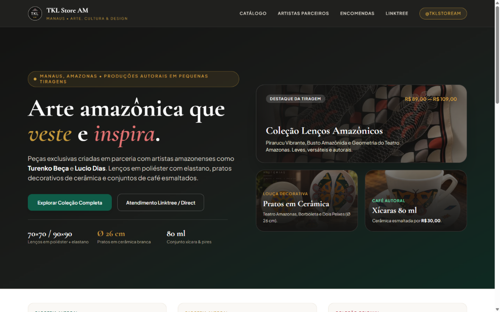
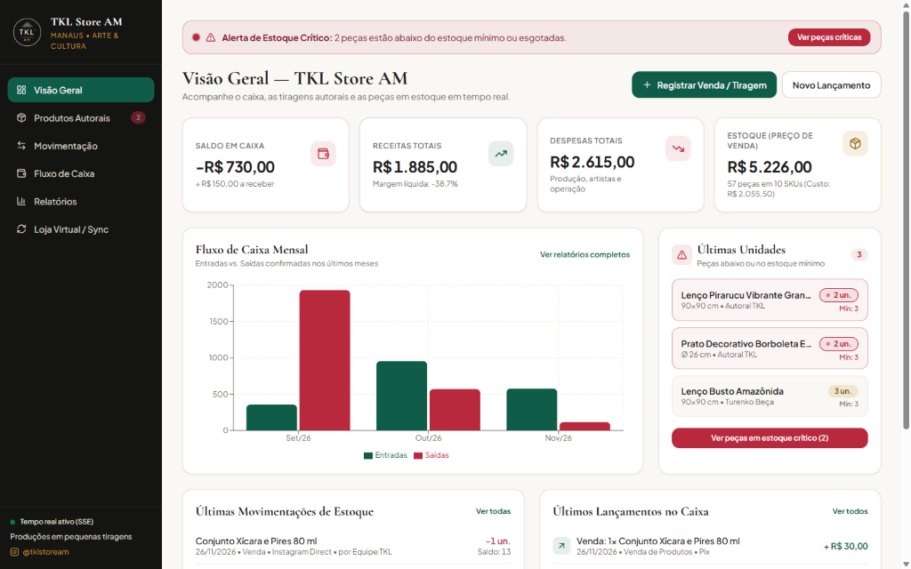

# TKL Store AM — Vitrine Autoral, Gestão Financeira e Controle de Estoque

Ecossistema digital desenvolvido para a **TKL Store AM — Arte, Cultura & Design (Manaus/AM)**, especializada em produções autorais em pequenas tiragens (lenços, pratos decorativos e xícaras) em parceria com artistas amazonenses.

---

## Links Públicos (GitHub Pages)

> Após ativar o **GitHub Pages** (`Settings → Pages → Branch: main → /docs`), seu cliente poderá acessar diretamente:
> - **Portfólio de Apresentação:** `https://marcelovdias.github.io/tkl-store-am/`
> - **Vitrine Pública Interativa (PC & Mobile):** `https://marcelovdias.github.io/tkl-store-am/vitrine/`

---

## Prévia Visual

### 1. Vitrine Pública (PC Widescreen & Mobile 9:16)


- Layout em **tela cheia widescreen** no computador e formato **vertical 9:16** no celular.
- Fotos reais do catálogo `@tklstoream`, filtro por categoria e modal de pedido direcionado para **WhatsApp** e **Instagram Direct** (`ig.me/m/tklstoream`) com mensagem preenchida.

### 2. Plataforma de Gestão Financeira e Estoque (Node.js + SQLite + React + Tailwind)


- **Produtos Autorais:** Controle de tiragens, artistas parceiros, custo, margem e coluna **Estoque / Mínimo** com destaque para peças críticas/esgotadas.
- **Alertas de Estoque Crítico:** Banner global no topo do sistema e painel **Últimas Unidades** no Dashboard.
- **Movimentação com Rastreabilidade:** Registro obrigatório de **quem movimentou** (`moved_by`), canal de venda e integração automática ao Fluxo de Caixa.
- **Fluxo de Caixa & Relatórios:** Entradas/saídas, troca rápida `Pendente ↔ Confirmado`, gráficos interativos por categoria/artista/canal e exportação **CSV** (UTF-8 BOM) e **PDF**.
- **Integração em Tempo Real & Blindagem:** Atualização ao vivo via **SSE** (`/api/events`) e Webhook protegido (`/api/integrations/webhook/order`) contra chave inválida, SKU inexistente, furo de estoque, divergência de valor e duplicidade (idempotência), além de **Backup Completo (JSON)**.

---

## Estrutura do Projeto

```text
tkl-store-am/
├── backend/          # API REST Node.js + Express + SQLite (node:sqlite) + Zod
├── frontend/         # Interface React + Vite + Tailwind CSS + Recharts
├── vitrine/          # Vitrine pública estática (Fase 1 - hospedagem gratuita)
├── portfolio/        # Portfólio estático com capturas reais (pronto para PDF)
├── docs/             # Pacote publicado automaticamente no GitHub Pages
└── scripts/          # Utilitários (dev simultâneo e túnel de compartilhamento)
```

---

## Como Executar Localmente

```bash
# 1. Instalar dependências (back-end e front-end)
npm run install:all

# 2. Compilar o front-end de produção
npm run build

# 3. Iniciar o sistema completo (http://localhost:3001)
npm start
```

### Outros Comandos Úteis
- `npm run dev` — Inicia back-end e front-end em modo desenvolvimento (hot reload).
- `npm test` — Executa a suíte de testes automatizados da API (`node:test`).
- `npm run share` — Abre um túnel HTTPS temporário para o cliente testar o painel ao vivo.
